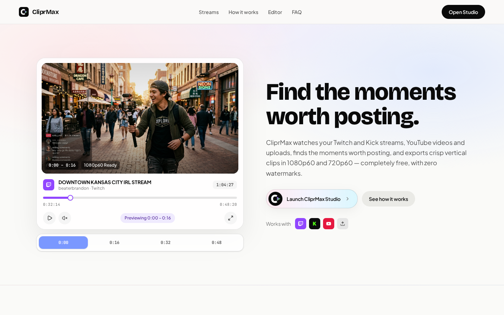
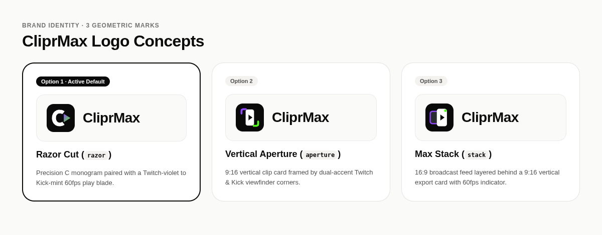
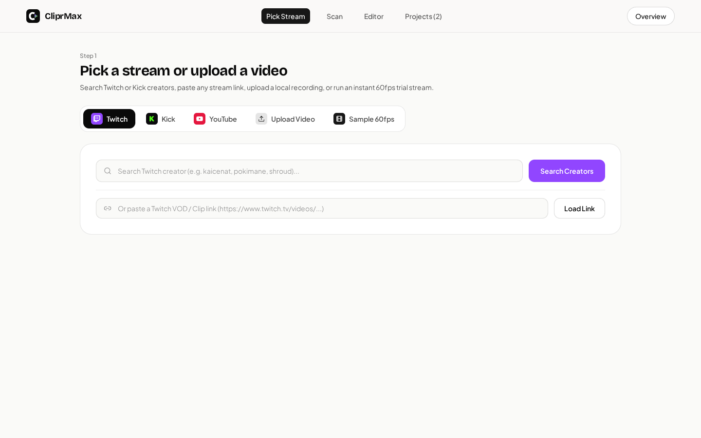
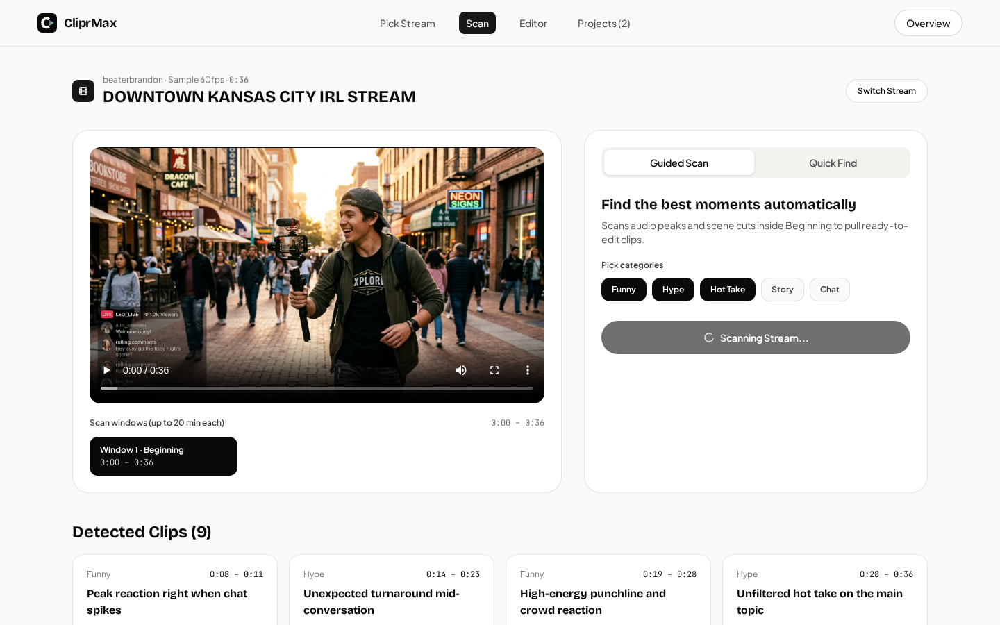
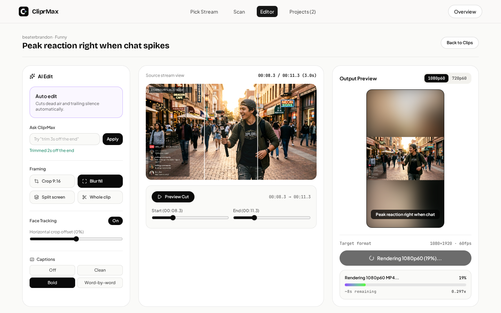
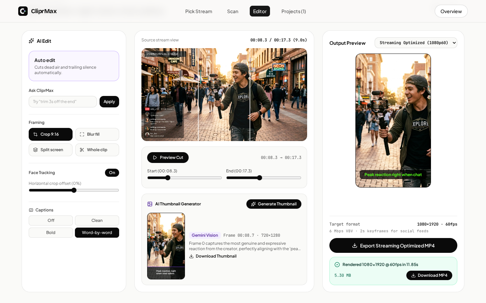
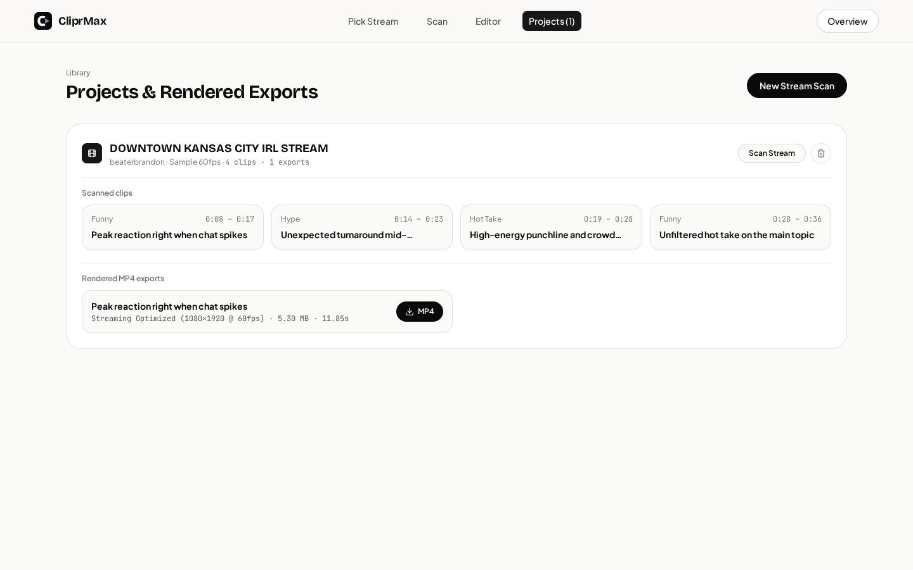
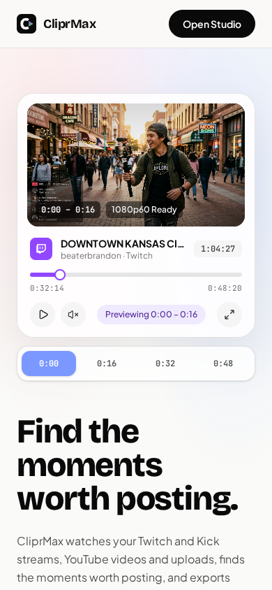

# CliprMax

Free, fast full-stack stream clipping studio for **Twitch**, **Kick**, **YouTube**, and **local video uploads** with automated highlight scanning, natural-language timeline editing (**Ask CliprMax**), real-time FFmpeg render progress tracking, and hardware-tuned **1080p60** & **720p60** vertical MP4 exports.



---

## Features

- **Completely Free · Zero Watermarks**: All scanning, AI editing, captions, and `1080p60` / `720p60` exports are unlocked with no paywall or usage caps.
- **Multi-Platform Stream Ingestion**:
  - **Twitch**: Live creator search and archived VOD browsing via Twitch GraphQL, plus direct VOD/clip URL resolution.
  - **Kick**: Channel and past VOD discovery via Kick API v2 (with TLS fallback), plus direct stream/VOD URL support.
  - **YouTube**: `yt-dlp` stream extraction with automatic `oEmbed` metadata fallback and optional Netscape `cookies.txt` support.
  - **Local Recordings**: Direct upload for `.mp4`, `.mov`, `.webm`, and `.mkv` files (up to 512 MB) with automatic FFmpeg frame thumbnail extraction.
  - **Instant 60fps Sample Streams**: Built-in 60fps IRL, Gaming, and Car Podcast samples for zero-setup testing.
- **Guided Scan & Quick Find**:
  - Partitions long VODs into up to three 20-minute windows (**Beginning**, **Middle**, **End**).
  - Runs FFmpeg `silencedetect` and scene-change detection (`select='gt(scene,0.22)'`), optionally ranked by Gemini (`gemini-4-hydrogen`).
- **AI Clip Editor, Thumbnail Generator, Real-Time Progress & Quality Presets**:
  - **Auto Edit**: Trims leading and trailing dead air automatically via FFmpeg `silencedetect`.
  - **Ask CliprMax**: Plain-English timeline/framing/caption commands (deterministic parser + Gemini fallback), including quality preset commands (`"high quality"`, `"streaming optimized"`, `"small file"`).
  - **4 Framing Modes**: `Crop 9:16` (with Face Tracking & horizontal pan offset), `Blur Fill`, `Split Screen` (facecam stacked above gameplay), and `Whole Clip` (`16:9`).
  - **Burned-In ASS Captions**: `Word-by-word` (Karaoke), `Bold`, `Clean`, or `Off`.
  - **AI Thumbnail Generator (`POST /api/clips/thumbnail`)**: Samples 4 frames across the trimmed clip, uses Gemini Vision (`gemini-4-hydrogen` with `gemini-3.1-flash-lite` & FFmpeg keyframe fallback) to select the most expressive frame, and composites a framing-matched JPEG (`720×1280` or `1280×720`) with a dark gradient scrim, Twitch-violet accent bar, and wrapped clip title overlay ready to download.
  - **Export Quality Preset Dropdown**: Switch between **`Standard 1080p60`**, **`Standard 720p60`**, **`High Quality (1080p60)`** (CRF 16, `-preset faster`, 256k audio), **`Streaming Optimized (1080p60)`** (6 Mbps VBV, 2s keyframes), and **`Small File Size (720p30)`** (CRF 27, 30fps, compact bitrate).
  - **Live Render Progress Bar & ETA**: Streams real-time FFmpeg `-progress pipe:1` (`out_time_us` & encode speed) over NDJSON (`POST /api/clips/export`), showing live percentage (`%`), stage label, and estimated seconds remaining in `ClipEditor`.
- **Projects Library**: Persists scanned clips, AI-generated thumbnails, project metadata, and downloadable MP4 exports (with preset labels) in `data/projects.json`.

---

## Logo Concepts

Three custom geometric SVG logo marks are saved in [`docs/logos/`](docs/logos/) and exposed in [`src/components/ClipMaxLogo.tsx`](src/components/ClipMaxLogo.tsx) (`CliprMaxLogo` / `ClipMaxLogo`) via the `variant` prop (`'razor' | 'aperture' | 'stack'`):



1. **Razor Cut (`razor`, active default)** — [`clipmax-2-razor.svg`](docs/logos/clipmax-2-razor.svg) — Precision `C` monogram paired with a Twitch-violet to Kick-mint 60fps play blade.
2. **Vertical Aperture (`aperture`)** — [`clipmax-1-aperture.svg`](docs/logos/clipmax-1-aperture.svg) — Vertical 9:16 crop frame enclosed by corner brackets.
3. **Max Stack (`stack`)** — [`clipmax-3-stack.svg`](docs/logos/clipmax-3-stack.svg) — Dual-layer 16:9 stream card + 9:16 vertical clip card representing Blur Fill & Split Screen framing.

---

## Screenshots

| Stream Picker (Twitch / Kick / YouTube / Upload) | Scan Workspace (Guided Scan & Quick Find) |
| --- | --- |
|  |  |

| Real-Time Render Progress (% & ETA) | AI Thumbnails & Quality Preset Export |
| --- | --- |
|  |  |

| Projects & Rendered Exports Library | Mobile Responsive Overview |
| --- | --- |
|  |  |

---

## Architecture & Tech Stack

```text
cliprmax/
├── server.ts                  # Express API + Vite dev middleware / static prod server (port 3000)
├── server/
│   ├── gemini.ts              # Server-side @google/genai client (moment labeling, Ask CliprMax & thumbnail frame selection)
│   ├── mediaEngine.ts         # FFmpeg/FFprobe probing, silence/scene scan, AI thumbnail rendering, ASS subtitles & preset MP4 export
│   ├── store.ts               # Atomic JSON project store & strict path confinement helpers
│   └── streamProviders.ts     # Twitch GQL, Kick v2, YouTube oEmbed + yt-dlp segment downloader
├── src/
│   ├── shared/types.ts        # Shared TypeScript contracts across client & server
│   ├── utils/
│   │   ├── clipMath.ts        # Pure URL parsing, preset specs, progress/ETA math, thumbnail framing & Ask CliprMax parser
│   │   └── clipMath.test.ts   # Node native test runner suite (8/8 passing)
│   └── components/
│       ├── ClipMaxLogo.tsx    # Custom geometric SVG marks ('razor' | 'aperture' | 'stack')
│       ├── Navbar.tsx
│       ├── HeroSection.tsx
│       ├── LandingSections.tsx
│       └── studio/            # StreamPicker, ScanWorkspace, ClipEditor, ProjectsLibrary
└── docs/
    ├── logos/                 # Standalone SVG logo options
    └── screenshots/           # Desktop, Studio & mobile verification captures
```

---

## Prerequisites & Setup

### System Binaries
- **Node.js `22+`** (uses native TypeScript execution for `npm start`)
- **`ffmpeg` & `ffprobe`** (`libx264`, `aac`, `libass`, `libfreetype`)
- **`yt-dlp`** (placed at `bin/yt-dlp` or available in `PATH`)

### Environment Variables
Copy `.env.example` to `.env` (optional `GEMINI_API_KEY` enables AI moment titles and open-ended **Ask CliprMax** edits):

```env
GEMINI_API_KEY="your_gemini_api_key"
APP_URL="http://localhost:3000"
```

### Scripts

```bash
npm install
npm run dev       # Start full-stack dev server on http://localhost:3000
npm run lint      # Run TypeScript type check (tsc --noEmit)
npm run build     # Build production frontend bundle into dist/
npm start         # Run production server natively with node server.ts
npx tsx --test src/utils/clipMath.test.ts  # Run pure logic unit tests
```
